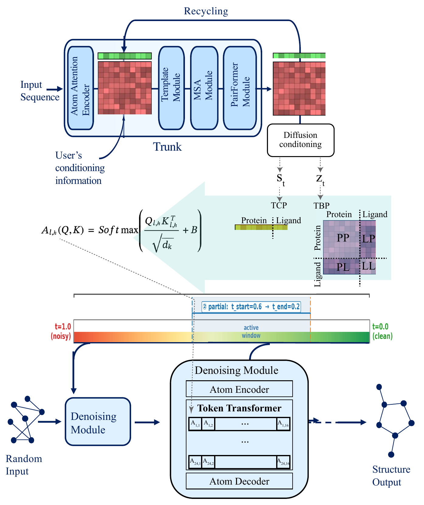
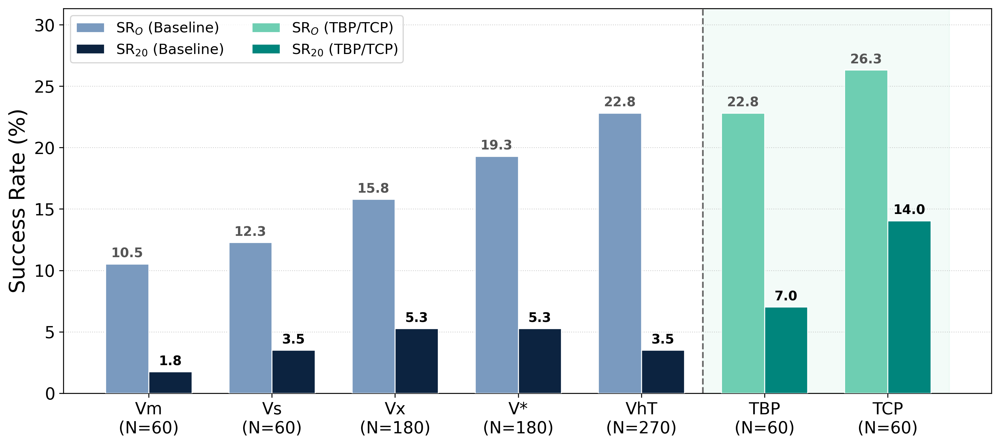
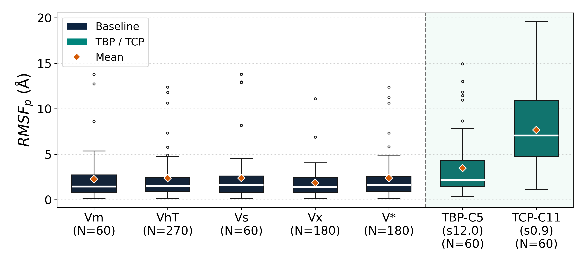
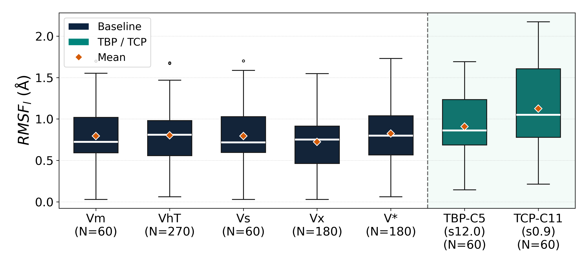
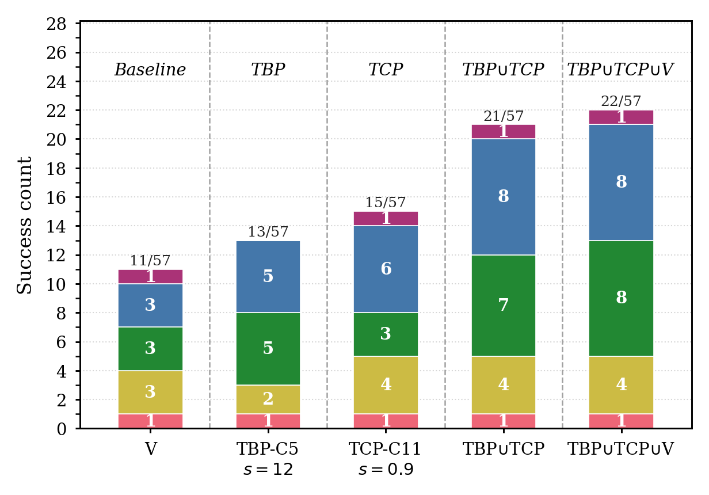

<div align="center">
  <h1>Boltz-Perturb</h1>
  <p><em>Unlocking Generative Diversity in Co-Folding Models via Training-Free Conditioning Perturbation</em></p>
</div>

---

## Overview

**Boltz-Perturb** is a training-free perturbation framework that injects time-annealed noise into the conditioning signals of [Boltz-2](https://doi.org/10.1101/2025.06.14.659707)'s denoising module during inference. By perturbing internal representations — token embeddings and attention biases — we redirect diffusion trajectories toward alternative conformational regions, improving both ligand pose diversity and structural accuracy without retraining.

We introduce two complementary perturbation strategies:

- **Token Conditioning Perturbation (TCP)**: Injects noise into the single conditioning signal `s_t` after diffusion conditioning, targeting ligand token embeddings.
- **Token Bias Perturbation (TBP)**: Injects noise into the pairwise attention bias `B` derived from the trunk representation `z_ij`, targeting protein–ligand interaction regions.

### Key Results
- For some cases, it is sampling problem not learning problems.
- We demonstrate that Boltz-Perturb generates more diverse structures, and that integrating TBP and TCP with vanilla Boltz yields up to a two-fold improvement in success rate over vanilla Boltz alone.
- Perturbation methods outperformed all baselines including elevated temperature, MSA masking, MSA subsampling, and steering potentials.
- This is the first perturbation analysis of an AF3-style co-folding architecture for small-molecule binding mode diversity.

## Architecture

<div align="center">
  
  <p><em>Figure 1. Boltz-Perturb framework. TCP perturbs the single conditioning token embeddings (s_t), while TBP perturbs the pairwise attention bias (B). Both perturbations follow time-annealed noise scheduling (TADS).</em></p>
</div>

## Method

Both perturbation strategies share two components:

1. **Noise scheduling (TADS)**: Time-dependent linear decay that reduces perturbation magnitude as denoising progresses, ensuring early-stage diversity without corrupting final structure quality.

2. **Perturbation generation and injection**: Context-aware noise scaled by the local standard deviation of the conditioning signal, followed by optional regularization (moment-matching rescaling, norm-preserving projection, and ψ-interpolation).

We additionally introduce **TADS-auto**, an adaptive schedule that monitors the model's own noise variance during diffusion and automatically calibrates perturbation timing and magnitude — reducing reliance on manual hyperparameter tuning.

## Results

### Success Rate & Ligand RMSD

<div align="center">
  
  <p><em>Figure 2. Success rate (RMSD < 2Å) comparison across perturbation methods and baselines on the RnP benchmark (57 targets).</em></p>
</div>

### Conformational Diversity (RMSF)

<div align="center">
  
  <p><em>Figure 3. Per-target RMSF (Å) with protein context — higher values indicate greater conformational diversity.</em></p>
</div>

<div align="center">
  
  <p><em>Figure 4. Per-target RMSF (Å) ligand-only alignment.</em></p>
</div>

### SuCOS Pocket Similarity Stratification

<div align="center">
  
  <p><em>Figure 5. Success count (RMSD < 2Å) stratified by ligand pocket shape similarity (SuCOS score) to training set structures.</em></p>
</div>

## Installation

```bash
git clone https://github.com/MSDLLCpapers/boltz-perturb
cd boltz-perturb
pip install -e .[cuda]
```

## Quick Start
- For the full original Boltz prediction CLI parameters check docs/prediction.md
### Token Conditioning Perturbation (TCP)

```bash
boltz predict /path/to/input.yaml \
    --checkpoint /path/to/boltz2_conf.ckpt \
    --out_dir /path/to/output \
    --diffusion_samples 5 \
    --noise_s \
    --s_noise_scale 0.9 \
    --s_noise_t_start 1.0 \
    --s_noise_t_end 0.0 \
    --s_noise_psi 0.7
```

### Token Bias Perturbation (TBP)

```bash
boltz predict /path/to/input.yaml \
    --checkpoint /path/to/boltz2_conf.ckpt \
    --out_dir /path/to/output \
    --diffusion_samples 5 \
    --noise_token_bias \
    --token_bias_noise_scale 3.0 \
    --token_bias_t_start 1.0 \
    --token_bias_t_end 0.0 \
    --token_bias_psi 0.7 \
    --token_bias_mode cross_and_ll
```

### TADS-auto (adaptive scheduling)

Add `--tads_auto_token_bias` for TBP or `--tads_auto_s_noise` for TCP to either perturbation to use automatic noise scheduling that calibrates perturbation based on the diffusion noise level:
For the token bias tads auto
```bash
boltz predict /path/to/input.yaml \
    --checkpoint /path/to/boltz2_conf.ckpt \
    --out_dir /path/to/output \
    --noise_token_bias \
    --token_bias_noise_scale 3.0 \
    --tads_auto_token_bias
```

## Parameters

### TCP — Token Conditioning Perturbation (`--noise_s`)

| Parameter | Default | Description |
|-----------|---------|-------------|
| `--s_noise_scale` | 0.7 | Maximum noise magnitude (σ_max) |
| `--s_noise_t_start` | 1.0 | Schedule start time (1.0 = beginning of denoising) |
| `--s_noise_t_end` | 0.0 | Schedule end time (0.0 = end of denoising) |
| `--s_noise_psi` | 0.7 | Interpolation weight ψ (1.0 = full perturbation, 0.0 = original) |
| `--no_s_noise_rescale` | False | Disable moment-matching rescaling |
| `--no_s_noise_norm_proj` | False | Disable norm-preserving projection |
| `--tads_auto_s_noise`| False| Use TADS-auto adaptive noise scheduling |

### TBP — Token Bias Perturbation (`--noise_token_bias`)

| Parameter | Default | Description |
|-----------|---------|-------------|
| `--token_bias_noise_scale` | 10.0 | Maximum noise magnitude (σ_max) |
| `--token_bias_t_start` | 1.0 | Schedule start time |
| `--token_bias_t_end` | 0.0 | Schedule end time |
| `--token_bias_psi` | 0.7 | Interpolation weight ψ |
| `--token_bias_mode` | cross_and_ll | Perturbation region: `cross_only`, `cross_and_ll`, `ll_only`, `all` |
| `--no_token_bias_rescale` | False | Disable moment-matching rescaling |
| `--no_token_bias_norm_proj` | False | Disable norm-preserving projection |
| `--tads_auto_token_bias`| False| Use TADS-auto adaptive noise scheduling |

 
## Perturbation Modes (TBP)

The `--token_bias_mode` flag controls which token-pair regions receive noise:

| Mode | Region |
|------|--------|
| `cross_only` | Protein–ligand cross-attention pairs only |
| `cross_and_ll` | Protein–ligand cross + ligand–ligand self-attention |
| `ll_only` | Ligand–ligand self-attention pairs only |
| `all` | All token pairs |

## Analysis Scripts

Example analysis scripts are provided in `scripts/utils/analyze_scripts/`:

- `align_and_save_predictions.py` — Align predicted structures to reference via PyMOL and extract ligand SDFs
- `calculate_rmsd_ost.py` — Compute protein/ligand RMSD using OpenStructure
- `combine_ost_results.py` — Aggregate OST comparison results into a single CSV
- `validity_and_rmsf.py` — Check ligand chemical validity (PoseBusters) and compute per-atom RMSF

**Note:** `align_and_save_predictions.py` requires [PyMOL](https://pymol.org/), which is not included in the default installation due to its license.  Please install it separately before running analysis scripts.
- **Academic/Open-Source version**: [PyMOL Open-Source](https://github.com/schrodinger/pymol-open-source)
- **Commercial version**:  Please check with your institution for a licensed version.

## Project Structure

```
├── src/boltz/
│   ├── main.py                          # CLI entry point with perturbation options
│   └── model/
│       ├── models/boltz2.py             # Model class (passes noise args to diffusion)
│       └── modules/diffusionv2.py       # Perturbation injection logic (TCP/TBP)
├── scripts/utils/
│   ├── run_scripts/
│   │   ├── run_s_noise.sh              # Example: TCP perturbation
│   │   └── run_token_bias_noise.sh     # Example: TBP perturbation
│   └── analyze_scripts/
│       ├── align_and_save_predictions.py
│       ├── calculate_rmsd_ost.py
│       ├── combine_ost_results.py
│       └── validity_and_rmsf.py
```

## Citation

If you use Boltz-Perturb in your research, please cite:

```bibtex
@article{boltzperturb2026,
  title={Boltz-Perturb},
  author={Hyeyun Jung, BoRam Lee, Alan C. Cheng},
  journal={TODO},
  year={2026},
  url={TODO}
}
```

And the underlying Boltz models:

```bibtex
@article{passaro2025boltz2,
  author = {Passaro, Saro and Corso, Gabriele and Wohlwend, Jeremy and others},
  title = {Boltz-2: Towards Accurate and Efficient Binding Affinity Prediction},
  year = {2025},
  doi = {10.1101/2025.06.14.659707},
  journal = {bioRxiv}
}

@article{wohlwend2024boltz1,
  author = {Wohlwend, Jeremy and Corso, Gabriele and Passaro, Saro and others},
  title = {Boltz-1: Democratizing Biomolecular Interaction Modeling},
  year = {2024},
  doi = {10.1101/2024.11.19.624167},
  journal = {bioRxiv}
}
```

## License

This code is released under the MIT License.

## Contributing

Please open an issue or submit a pull request for bug reports or feature requests.

## Authors

Hyeyun Jung (MSD), BoRam Lee (MSD), Alan C. Cheng (MSD)

