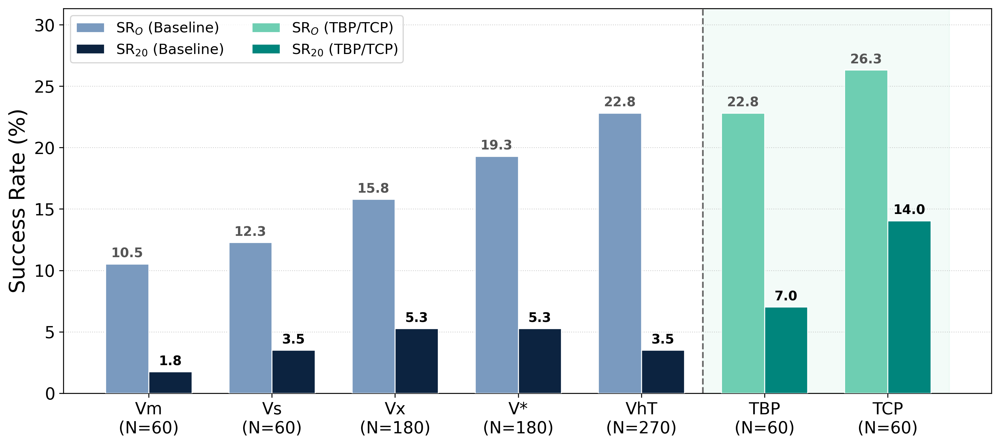
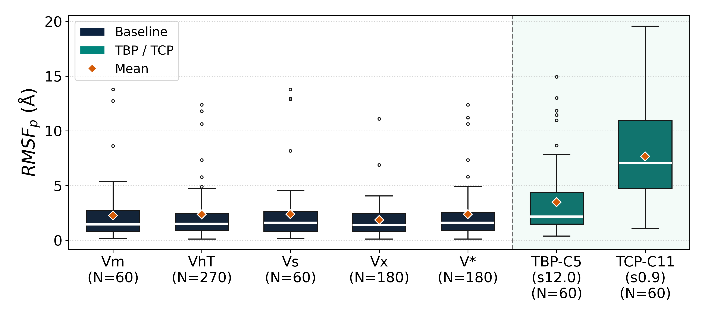
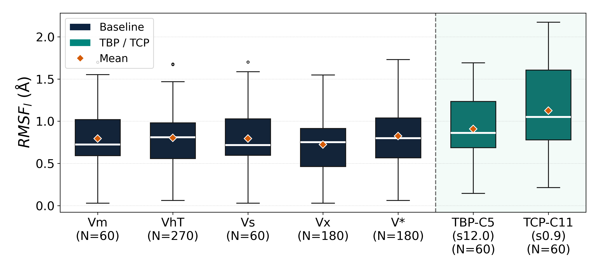
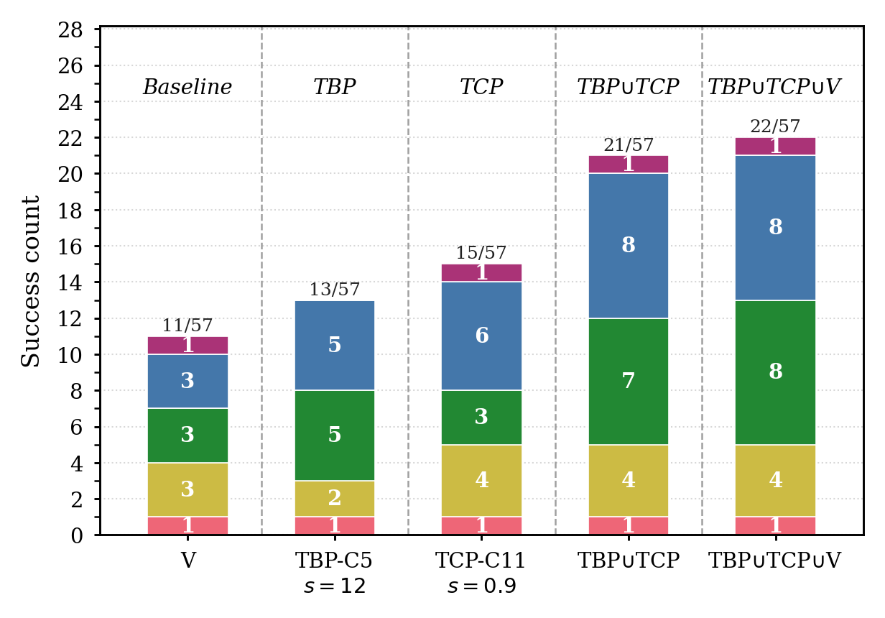

# Evaluation

Benchmark results for Boltz-Perturb are shown below. For the full write-up and discussion, see the [Results section of the README](../README.md#results).

## Success Rate & Ligand RMSD

  
  
<em>Figure 1. Success rate (RMSD < 2Å) comparison across perturbation methods and baselines on the RnP benchmark (57 targets).</em>

## Conformational Diversity (RMSF)

  
  
<em>Figure 2. Per-target RMSF (Å) with protein context — higher values indicate greater conformational diversity.</em>

  
  
<em>Figure 3. Per-target RMSF (Å) ligand-only alignment.</em>

## SuCOS Pocket Similarity Stratification

  
  
<em>Figure 4. Success count (RMSD < 2Å) stratified by ligand pocket shape similarity (SuCOS score) to training set structures.</em>

For evaluation of the original Boltz-2 & code, see: https://github.com/jwohlwend/boltz.
## Analysis scripts

The metrics and figures above are produced by the analysis scripts in
[`scripts/utils/analyze_scripts/`](../scripts/utils/analyze_scripts/). They are meant
to be run in order on a directory of Boltz-Perturb predictions:

1. **`align_and_save_predictions.py`** — Aligns predicted structures to a reference
   (PyMOL superposition on the protein chain) and extracts per-conformer ligand SDFs.
2. **`calculate_rmsd_ost.py`** — Computes protein and ligand RMSD against the reference
   using [OpenStructure](https://openstructure.org/) (`ost`), writing per-prediction JSON.
3. **`combine_ost_results.py`** — Aggregates the per-prediction OpenStructure JSON outputs
   into a single CSV, tagged by method / model / noise type.
4. **`validity_and_rmsf.py`** — Runs [PoseBusters](https://github.com/maabuu/posebusters)
   ligand validity checks and computes per-atom RMSF across conformers (the diversity
   metric shown in Figures 2–3).

Each script exposes a `--help` / usage docstring at the top of the file. Paths and chain
IDs must be set to match your local prediction outputs.

> The example run scripts that generate the predictions consumed here live in
> [`scripts/utils/run_scripts/`](../scripts/utils/run_scripts/)
> (`run_s_noise.sh` for TCP, `run_token_bias_noise.sh` for TBP).
